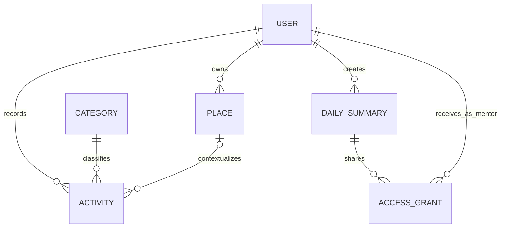

# 3. Podatkovni model

**Baza:** PostgreSQL; relacijski model s primarnimi ključi `id` in tujimi ključi `*_id`.

## Model podatkov

| Entiteta | Glavna polja | Namen |
|---|---|---|
| User | id, email (unikaten), password_hash, role, created_at | Račun; vloga USER, MENTOR ali ADMIN. |
| Place | id, user_id, name, latitude, longitude, radius_m | Uporabnikov znani kraj za lokacijski kontekst. |
| Category | id, code (unikaten), name, active | Skupni širši tipi aktivnosti, npr. študij, delo, prevoz, šport, druženje in obrok. Stabilni code določa strukturo dodatnih podatkov. |
| Activity | id, user_id, category_id (izbiren za osnutek), place_id (izbiren), title, description (izbiren), start_at, end_at, source, status, details, schema_version, raw_input (izbiren), created_at, updated_at | Časovni blok ali osnutek predloga. Vir MANUAL, SUGGESTION ali AI; stanje DRAFT ali CONFIRMED. Podrobnosti so JSONB, raw_input pa izvorno besedilo oziroma poznejši prepis glasovnega vnosa. |
| DailyReflection | id, user_id, date, mood (izbiren), energy (izbiren), note (izbiren), created_at, updated_at | Zasebna refleksija dneva, ki ni nov časovni blok. mood je kratka besedilna oznaka počutja, energy pa neobvezna samoocena od 1 do 5. |
| DailySummary | id, user_id, date, category_totals, comment (izbiren), created_at | Posnetek povzetka dneva brez lokacij, podrobnih opisov, izvornih vnosov in zasebnih refleksij. comment je besedilo, ki ga lastnik izrecno nameni povzetku za deljenje. |
| AccessGrant | id, summary_id, mentor_id, created_at, revoked_at (izbiren) | Izrecno dodeljen bralni dostop mentorju do določenega posnetka povzetka. |

## Osnutek modela

