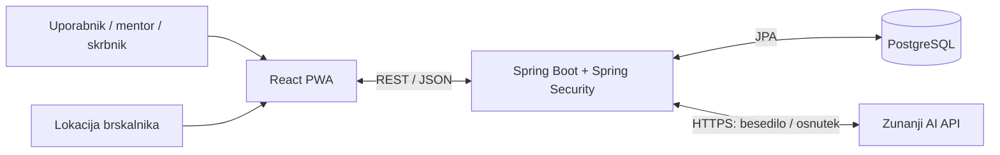

# 4. Arhitektura in tehnološki sklad

## Deli sistema in komunikacija

- **Frontend:** odzivna spletna aplikacija za vnos, potrjevanje, dnevni pregled in deljenje.
- **Backend:** REST API; preverja pravice, validira aktivnosti, izračuna povzetke in pripravlja predloge.
- **Baza:** PostgreSQL za račune, kraje, aktivnosti, kategorije in deljene povzetke.
- **AI API:** backend pošlje besedilo in nujen kontekst; odgovor pretvori v preverjen osnutek.
- Frontend in backend komunicirata prek HTTP/JSON, ob objavi prek HTTPS; backend dostopa do baze prek JPA.
- Lokacijo pridobi brskalnik z dovoljenjem uporabnika med uporabo aplikacije.

## Tehnološki sklad

| Del | Predvidena tehnologija / orodje |
|---|---|
| Frontend | React, Vite, PWA z osnovnim predpomnjenjem vmesnika |
| Backend | Java, Spring Boot, Spring Data JPA |
| Podatkovna baza | PostgreSQL; Flyway za spremembe sheme |
| Avtentikacija | Spring Security, strežniška seja, BCrypt za gesla |
| Lokalni razvoj | Docker Compose, Maven, npm, Git |
| Lokacija | Brskalniški Geolocation API |
| Jezikovni vnos | Zunanji AI API prek backenda; ponudnik se izbere ob implementaciji |

## Avtentikacija in pravice

- Registracija ustvari navadnega uporabnika; vlogo mentorja dodeli skrbnik.
- Začetni skrbniški račun se nastavi prek okoljskih spremenljivk ob lokalnem zagonu.
- Prijava z e-pošto in geslom; seja uporablja piškotek HttpOnly, ob objavi tudi Secure.
- Backend preverja vlogo, lastništvo in dovoljenja za povzetke ter uporablja zaščito CSRF.
- Mentor vidi le izrecno deljene povzetke; skrbniški API ne omogoča branja dnevnikov.

## Predvideni lokalni zagon

- Predpogoji: Docker z Docker Compose; za besedilni vnos tudi dostop do AI API-ja.
- `.env.example` bo opisoval nastavitve baze, začetnega skrbnika in `AI_API_KEY`; lokalna `.env` se ne shrani v Git.
- `docker compose up --build` zažene frontend, backend in bazo.
- Frontend: `http://localhost:5173`; Vite posreduje `/api` na backend na vratih 8080.
- Baza uporablja trajni Docker volume; Flyway ob zagonu pripravi shemo.
- Brez AI ključa ostaneta ročni vnos in kontekstni predlog; besedilni vnos je onemogočen.
- To je načrt zagona; konfiguracija in aplikacija še nista implementirani.

## Arhitekturne odločitve

- **En backend:** manj infrastrukture in preprostejši razvoj za posameznika.
- **Relacijska baza:** jasne povezave, lastništvo in omejitve veljavnosti podatkov.
- **React PWA:** en vmesnik za telefon in računalnik brez ločene mobilne aplikacije zaradi kratkega/hitrega razvoja.
- **Strežniška seja:** preprosta prijava; frontend in API sta predvidena pod istim izvorom.
- **Pravila za predloge:** uporaba pogostosti potrjenih zapisov brez lastnega ML-modela zaradi kratkega/hitrega razvoja.
- **AI le za osnutke:** backend preveri odgovor, uporabnik potrdi zapis; ključ ostane na strežniku.
- **Posnetki povzetkov:** uporabnik nadzoruje vsebino, ki jo mentor vidi.
- **Docker Compose:** ponovljiv lokalni zagon in osnova za poznejšo objavo (prenosljivost-deploy).
