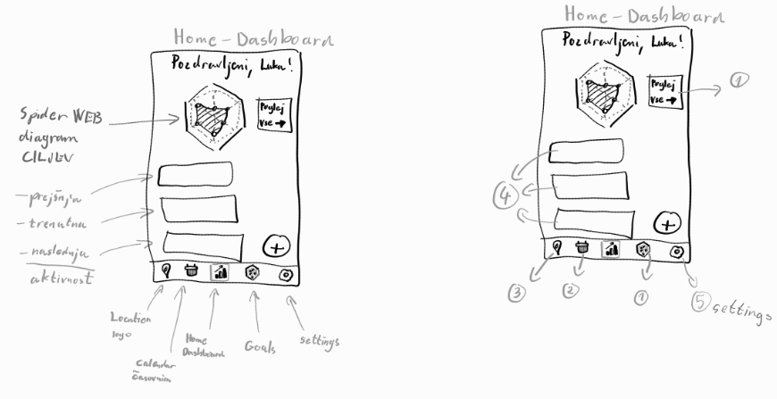
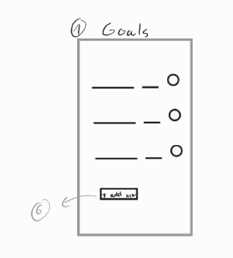
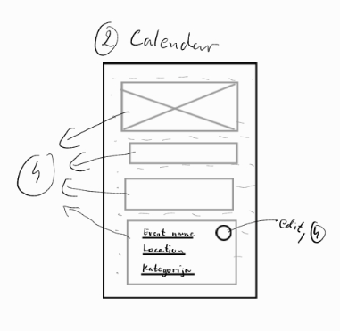
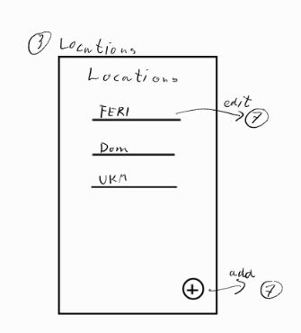
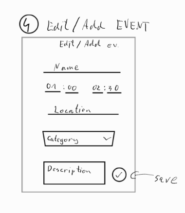

# Wireframei

## 00 Home – domača stran / dashboard

- Na vrhu je pozdrav uporabnika.
- Pajkov diagram prikazuje, koliko dnevnega časovnega cilja je uporabnik dosegel v posamezni kategoriji. Doseženi čas izhaja iz aktivnosti oziroma dogodkov na časovnici.
- Vsaka kategorija predstavlja eno os diagrama. Na primer: ena ura učenja pri cilju dveh ur zapolni polovico osi, ena ura športa pri cilju ene ure pa celotno os. Pri šestih kategorijah ima diagram šest osi.
- Ob diagramu je gumb za ogled vseh ciljev oziroma kategorij.
- Pod diagramom so prikazane tri aktivnosti: prejšnja zaključena aktivnost zgoraj, trenutna aktivnost na sredini in naslednja aktivnost spodaj.
- Spodaj desno je okrogel gumb za dodajanje aktivnosti oziroma dogodka.
- Spodnja navigacijska vrstica ima pet gumbov, od leve proti desni:
  - **Lokacije** – ikona lokacije, odpre seznam lokacij.
  - **Koledar** – ikona koledarja, odpre celotno časovnico dneva.
  - **Domov** – sredinski gumb, odpre dashboard.
  - **Cilji / kategorije** – ikona pajkovega diagrama ali druga, še nedoločena ikona; odpre isti zaslon kot gumb ob diagramu.
  - **Nastavitve** – nastavitve uporabnika oziroma profil; podrobna vsebina še ni določena.

## 01 Goals – kategorije in dnevni cilji

- Osnovna entiteta na zaslonu je kategorija. Vsaka kategorija ima ime in dnevni časovni cilj.
- Kategorije so prikazane v seznamu.
- Desno ob vsaki kategoriji je vrstica napredka, ki prikazuje današnji doseženi čas glede na njen cilj.
- Napredek je lahko prikazan kot dosežene minute glede na ciljne minute, v odstotkih ali z obojim; način prikaza še ni dokončno določen.
- Na dnu je možnost dodajanja nove kategorije in njenega cilja.
- Kategorije in njihovi cilji so podlaga za pajkov diagram na domači strani.

## 02 Calendar – dnevna časovnica

- Aktivnosti oziroma dogodki so prikazani kot bloki na dnevni časovnici, podobno kot v Google Koledarju.
- V ozadju je fiksna časovna mreža z označenimi urami ter črtkanimi ali zabrisanimi črtami.
- Vsak blok prikazuje ime aktivnosti, lokacijo in kategorijo.
- Klik na aktivnost odpre obrazec za ogled in urejanje dogodka (zaslon 0-4).
- Ločenega gumba za urejanje na bloku ni.

## 03 Locations – lokacije

- Lokacije so prikazane v seznamu, podobno kot kategorije.
- Na tem zaslonu je pri vsaki lokaciji prikazan samo njen naziv.
- Na dnu je gumb za dodajanje lokacije.
- Urejanje lokacije ter vnos naslova in koordinat sodijo na ločen zaslon, ki bo dodan pozneje.

## 04 Event Form – dodajanje in urejanje aktivnosti

- Naslov zaslona je odvisen od načina: **Add event** ali **Edit event**.
- Obrazec vsebuje naslednja polja:
  - ime oziroma naziv aktivnosti;
  - začetni in končni čas;
  - lokacijo;
  - kategorijo, izbrano iz spustnega seznama;
  - opis aktivnosti v večjem besedilnem polju.
- Gumb za glasovno narekovanje omogoča diktiranje podatkov aktivnosti (manjka na sliki).
- Na koncu je gumb za shranjevanje aktivnosti.
